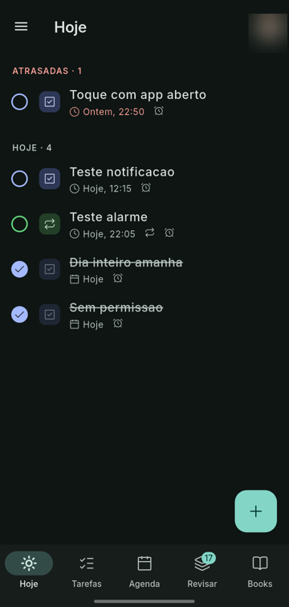
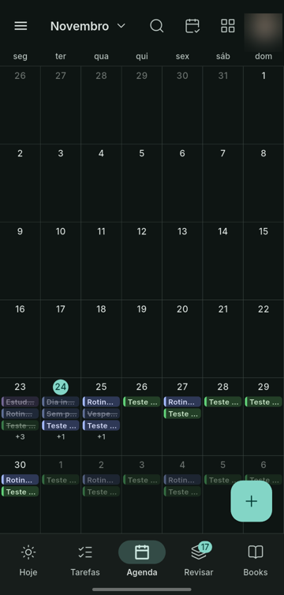
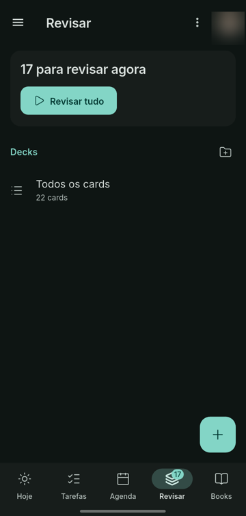
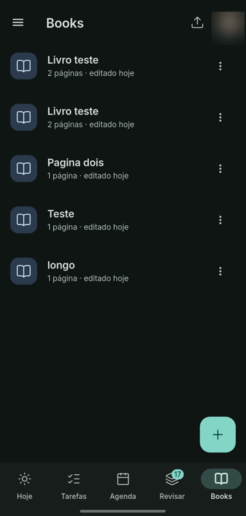

# My Cadence

App pessoal de organização para Android, offline-first, que junta num lugar só:

- **Tarefas** e subtarefas, com rotinas recorrentes e lembretes com alarme;
- **Flashcards** com repetição espaçada (algoritmo FSRS, o mesmo do Anki moderno);
- **Pomodoro** ligado às tarefas;
- **Books**: cadernos de páginas com editor rico (listas, tarefas, citações, tabelas, imagens, código);
- **Agenda** com visões de dia, semana e mês, arrastando os blocos;
- **Métricas** de foco, revisões e rotinas.

A tarefa é o centro: cada uma vira um hub com os cards, o tempo de foco e as páginas dela. Tudo funciona sem
internet e fica no aparelho. Para usar em mais de um aparelho, o app sincroniza pelo Google Drive da própria
pessoa (pasta privada do app, sem servidor próprio); também há backup manual em JSON.

<p>
  
  
  
  
</p>

## Instalar

Baixe o `cadence-X.Y.Z.apk` da [última release](https://github.com/edenilsonmota/my-cadence/releases/latest)
e abra no celular (o Android pede para permitir a instalação dessa fonte). As versões novas instalam por cima,
sem perder dados, e o próprio app avisa quando sai uma (Ajustes → Atualizações).

Em celulares Samsung, tire o Cadence das "apps em suspensão" (Bateria → Limites de uso em segundo plano) para
os alarmes não atrasarem.

[Política de privacidade](docs/PRIVACIDADE.md)

## Desenvolvimento

Flutter 3.47+ (Dart 3.13) e Android SDK com a plataforma 37.

```bash
git clone https://github.com/edenilsonmota/my-cadence.git
cd my-cadence
flutter pub get
flutter run
flutter analyze && flutter test
```

O login com Google precisa dos IDs do cliente OAuth ([docs/google-cloud.md](docs/google-cloud.md)); sem eles o
app funciona normalmente, só sem sincronização. Versões e APK assinado: [docs/RELEASE.md](docs/RELEASE.md).

**Stack:** Flutter (Material 3 com sistema de design próprio, tema claro e escuro), Riverpod, go_router,
drift (SQLite), `fsrs`, `flutter_local_notifications`, AppFlowy Editor
([fork](https://github.com/edenilsonmota/appflowy-editor/tree/cadence/file-picker-13)), `google_sign_in` +
Drive API, `fl_chart`, ícones Lucide e fontes Inter, Literata e JetBrains Mono (OFL).

Mais detalhes: [plano do projeto](docs/PLANO.md), [sincronização](docs/SINCRONIZACAO.md) e
[sistema visual](docs/EVOLUCAO-VISUAL.md).

## Licença

[MIT](LICENSE)
